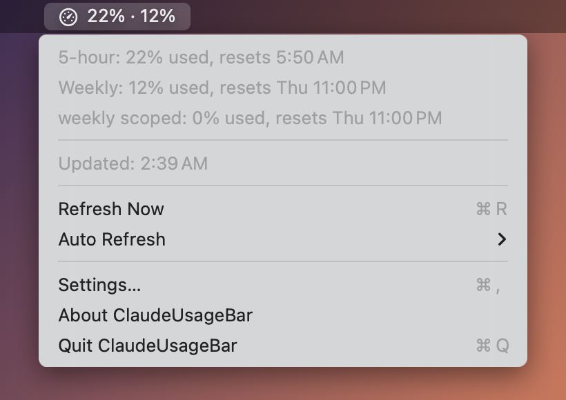

# ClaudeUsageBar

ClaudeUsageBar is a macOS menu bar app. It shows how much of your Claude plan limits you used.



The menu bar shows two values: the 5-hour limit and the weekly limit, for example `42% · 18%`, or `42 % · 18 %` in German.

The menu shows:

- Each limit, the percentage that you used, and the time when it resets.
- The extra usage and its cap, if extra usage is on.
- The time of the last update.
- An error message, if the last update failed. The menu bar then shows a warning triangle instead of the gauge.

[Rules](#rules) can show a notification or run a shortcut when a limit reaches a threshold.

The app is in English and German. It uses the language, time format and number format of your Mac.

## Requirements

- macOS 14 or later, on an Intel Mac or a Mac with Apple silicon.
- [Claude Code](https://claude.com/claude-code), logged in with a Claude account. The app reads the login token that Claude Code keeps in the Keychain.
- The Xcode Command Line Tools, only if you build the app yourself. See [CONTRIBUTING.md](CONTRIBUTING.md).

## Install

1. Download `ClaudeUsageBar.dmg` from the latest [release](https://github.com/mrcgrtz/claude-usage-bar/releases).
2. Open the file and drag `ClaudeUsageBar.app` to the `Applications` folder.
3. Open the app. The app is not notarised, thus macOS blocks it the first time. Go to **System Settings → Privacy & Security** and click **Open Anyway**.
4. When macOS asks for access to the `Claude Code-credentials` Keychain item, click **Always Allow**.

To start the app when you log in, turn on **Launch at Login** in **Settings…**.

## Build

```sh
./build.sh            # Builds build/ClaudeUsageBar.app
./build.sh --install  # Builds the app and copies it to ~/Applications
./build.sh --dmg      # Builds the app and makes build/ClaudeUsageBar.dmg
```

The app icon is `AppIcon.icns`. To change it, edit `scripts/make-icon.swift` and run `swift scripts/make-icon.swift` from the repository root.

The DMG window background is `DMGBackground.tiff`. To change it, edit `scripts/make-dmg-background.swift` and run `swift scripts/make-dmg-background.swift` from the repository root. The window layout is `DMGLayout.DS_Store`. If you move the icons in the picture, change their positions in `scripts/make-dmg-layout.sh` and run it on a Mac. Finder then opens the window for a short time and the script saves the new layout.

To use a custom menu bar icon, put a `claude-icon.png` file in the repository root before you build. Use a black icon on a transparent background. macOS changes its colour for light and dark menu bars.

## Use

- **Refresh Now** (⌘R) gets the usage data immediately.
- **Auto Refresh** sets the update interval: off, or every 5, 10, 20, 30 or 60 minutes. The default is 30 minutes.
- The app also gets new data 10 seconds after the Mac wakes from sleep.
- **Settings…** (⌘,) opens the settings. **General** has **Launch at Login**, and **Rules** has the rules. If you turned the app off in **System Settings → General → Login Items**, **Launch at Login** opens that page, so that you can turn it on again there.
- **About ClaudeUsageBar** shows the version and a link to the website of the developer.

## Rules

A rule does something when the usage of a limit reaches a threshold. For example, it can show a notification when the weekly usage reaches 80 %, or run a shortcut that turns on a Focus when the 5-hour usage reaches 95 %.

To add a rule, open **Settings…**, choose **Rules** and click **Add Rule**. To change a rule, double-click it or select it and click **Edit**. **Duplicate** copies the selected rule, and **Remove** (or the Delete key) removes it. Turn off **Active** to keep a rule without running it.

Each rule has:

- **Limit**: the 5-hour limit, the weekly limit or the extra usage. For the extra usage, the percentage is the amount that you spent of your cap.
- **Threshold**: the percentage, from 5 % to 100 %.
- **Show Notification**: shows a macOS notification. The first time, macOS asks if ClaudeUsageBar can send notifications.
- **Run Shortcut**: runs one of your shortcuts from the Shortcuts app.

A rule runs once when the usage reaches its threshold. It runs again only after the usage went below the threshold, for example when the limit resets. The app checks the rules each time that it gets new data, so a rule can run up to one auto refresh interval late.

The shortcut gets a JSON file as its input, for example:

```json
{"limit": "weekly_all", "percent": 82, "threshold": 80, "resetsAt": "2026-11-14T22:20:00Z"}
```

`limit` is `session` (5-hour), `weekly_all` (weekly) or `extra` (extra usage). To use the values in the shortcut, add the **Get Dictionary from Input** action. If a shortcut or a notification fails, the menu shows the error.

## Troubleshooting

| Message | Cause | Fix |
| --- | --- | --- |
| Claude Code Keychain credentials unavailable | The app cannot read the Keychain item. | Log in to Claude Code. Make sure that you allowed Keychain access. |
| Token expired - run claude to refresh it | The OAuth token is not valid anymore. | Run `claude` once. Claude Code then gets a new token. |
| Usage API returned HTTP … | The usage API sent an error. | Try again later. |
| Notifications are off for ClaudeUsageBar. … | A rule tried to show a notification, but notifications are off. | Turn on notifications for ClaudeUsageBar in **System Settings → Notifications**. |
| Shortcut “…” failed: … | A rule could not run its shortcut, for example because you deleted or renamed it. | Edit the rule and choose the shortcut again. Run the shortcut in the Shortcuts app to see its own errors. |

If the shortcut menu of a rule shows only **None**, close the rule with **Cancel** and open it again. The app loads your shortcuts when the rule opens, which can take a second.

## Release

GitHub builds the release when you push a version tag:

1. Change `CFBundleShortVersionString` in `Info.plist` and move the **Unreleased** entries in `CHANGELOG.md` to the new version.
2. Commit the change on `main`, then tag and push it:

   ```sh
   git tag v0.2
   git push origin main v0.2
   ```

The release workflow checks that the tag matches the version in `Info.plist`, runs `./build.sh --dmg` and makes a GitHub release with the DMG. The release notes are the section of the version in `CHANGELOG.md`.
